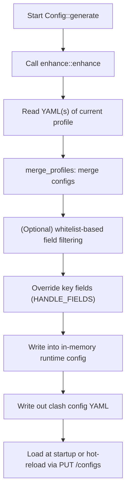

# Chimera Runtime Configuration: Inputs, Generation, and Loading

This page describes how Chimera prepares the configuration used by its core. At
startup and during hot reload, the core uses a generated runtime file rather
than reading `profiles.yaml` directly. The backend assembles the runtime
configuration in memory, writes it to disk, and provides it to the core through
startup arguments or the Clash API.

- Upstream alignment: Needs assessment
- Local maturity: In development

## 1. Inputs and Initialization

The runtime configuration draws on four kinds of input:

1. **Application settings** — `chimera-config.yaml`, represented by `IVerge` and
   loaded through `backend/tauri/src/config/chimera/mod.rs` → `IVerge::new()`.
   These settings control field filtering, port strategy, TUN behavior, and
   system-proxy behavior.
2. **Clash Guard overrides** — `clash-guard-overrides.yaml`, represented by
   `IClashTemp` and loaded through `backend/tauri/src/config/clash/mod.rs` →
   `IClashTemp::new()`. These values override selected fields such as `mode`,
   `mixed-port`, `external-controller`, and `secret`.
3. **Profile metadata** — `profiles.yaml`, represented by `Profiles` and loaded
   through `backend/tauri/src/config/profile/profiles.rs` → `Profiles::new()`.
   It records the active profile (`current`) and the profile list (`items`).
4. **Profile content** — `app_config_dir/profiles/*.yaml`, read through
   `Profiles::current_mappings()`. These files contain configuration such as
   proxies, rules, DNS, and TUN settings.

### Startup initialization

`backend/tauri/src/utils/init/mod.rs` → `init_config()` creates the following
files when they are missing:

- `clash-guard-overrides.yaml`, using `IClashTemp::template()`
- `chimera-config.yaml`, using `IVerge::template()`
- `profiles.yaml`, with an empty or default configuration

`backend/tauri/src/config/core.rs` → `Config::global()` initializes
`Profiles::new()`, `IVerge::new()`, `IClashTemp::new()`, and `IRuntime::new()`.
`IRuntime` holds the in-memory runtime configuration; its `config` field is an
`Option<Mapping>`.

## 2. Runtime Configuration Generation

The documented entry point is `Config::generate()` in
`backend/tauri/src/config/core.rs`:

`enhance::enhance()` in `backend/tauri/src/enhance/mod.rs` performs these steps:

1. Loads Clash Guard settings from `Config::clash().latest().0.clone()`.
2. Reads feature settings from `IVerge`, including `enable_clash_fields`.
3. Loads the active profile content through `Profiles::current_mappings()`. This
   iterates over `current`, reads each `profiles/<file>.yaml`, and converts it
   to a `Mapping`.
4. Calls `process_chain(...)` for profile-chain scripts. In the implementation
   described here, this is a placeholder and returns the original configuration
   unchanged.
5. Calls `merge_profiles(...)` to combine profile configurations. The first
   configuration is merged in full with `extend`; later configurations append
   only their `proxies` to the existing `proxies` list.
6. Optionally filters fields through `use_whitelist_fields_filter(...)`. When
   `enable_clash_fields = true`, only keys in the valid and default field sets
   are retained.
7. Copies the fields in `HANDLE_FIELDS` from `IClashTemp` into the final
   configuration so the client centrally controls these values.

`HANDLE_FIELDS`, defined in `backend/tauri/src/enhance/field.rs`, contains:

- `mode`
- `port`
- `socks-port`
- `mixed-port`
- `allow-lan`
- `log-level`
- `ipv6`
- `secret`
- `external-controller`

If a profile also defines one of these fields, the corresponding value from
`clash-guard-overrides.yaml` takes precedence.

## 3. Runtime File and Core Loading

`Config::generate_file(ConfigType::Run)` in `backend/tauri/src/config/core.rs`
writes the runtime output to `app_config_dir()/clash-config.yaml`. In `Check`
mode, it writes to `temp_dir()/clash-config-check.yaml`. If generation fails,
`Config::init_config()` falls back to writing `IClashTemp` directly as the
runtime configuration.

### At startup

`CoreManager::run_core()` → `Instance::try_new()` in
`backend/tauri/src/core/clash/core.rs` calls
`Config::generate_file(ConfigType::Run)` and passes the resulting path to the
core through `CoreInstanceBuilder.config_path(config_path)`. The core then reads
`clash-config.yaml` at startup.

### During hot reload

`CoreManager::update_config()` follows this sequence:

1. `Config::generate().await?` rebuilds the in-memory configuration.
2. `check_config().await?` validates it using the check file.
3. `generate_file(Run)` rewrites `clash-config.yaml`.
4. The client sends `PUT /configs` with `{ "path": "<absolute path>" }` to ask
   the core to reload it.

Relevant code is in `backend/tauri/src/core/clash/core.rs` → `update_config()`
and `backend/tauri/src/core/clash/api.rs` → `put_configs(...)`.

## 4. Operations That Trigger a Rebuild

### Changing the active profile selection

The frontend calls `commands.patchProfilesConfig`, which reaches
`patch_profiles_config(...)` in the backend. The backend applies a draft with
`Config::profiles().draft().apply(...)`, calls `CoreManager::update_config()`,
then saves the profile state with `Config::profiles().apply()` and `save_file()`
on success. On failure, it calls `discard()` to roll back.

### Changing selected application settings

The frontend calls `commands.patchVergeConfig`, which reaches
`feat::patch_verge(...)`. It first writes an `IVerge` draft. Depending on the
field, for example `enable_tun_mode`, the change may regenerate configuration
and restart the core through `Config::generate()` + `run_core()`, or hot-update
it through `update_core_config()`.

### Importing the first profile

After `import_profile(...)` succeeds, if no profile is active, Chimera sets
`ProfilesBuilder.current = [new_uid]` and reuses `patch_profiles_config(...)` to
trigger an update.

## 5. Runtime Details and Limitations

- `profiles.yaml` stores profile metadata and the `current` pointer; it is not
  the final configuration consumed by the core.
- Profile content files are not passed to the core verbatim. They become the
  runtime configuration after merging, filtering, and Clash Guard overrides.
- `prepare_external_controller_port()` checks port availability according to
  policy and changes the `external-controller` port when necessary.
- `verge_mixed_port` is primarily used by system-proxy logic. It is not written
  directly to the runtime YAML's `mixed-port`. System-proxy logic uses
  `verge_mixed_port` first, then falls back to
  `Config::clash().get_mixed_port()`.
- `get_runtime_yaml()` returns the in-memory `IRuntime.config`. It is usually
  consistent with the recently written `clash-config.yaml`, but it does not
  reread the file on each call.

The implementation limitations recorded here are:

- Profile-chain script execution is a placeholder; `process_chain(...)` does not
  yet rewrite the configuration.
- Global chain processing remains commented out; only the scoped chain framework
  is present.
- The `patch_clash_config` IPC is still `todo!()`, so the frontend will fail if
  it uses that IPC path.
- Editing a profile file directly does not automatically trigger hot reload.
  `save_profile_file(...)` writes the file but does not call `update_config()`.

## 6. Troubleshooting

If the core appears to be using the wrong configuration, check these items in
order:

1. **Active profile:** verify `current` in `profiles.yaml`.
2. **Profile content:** inspect the relevant file under
   `app_config_dir/profiles/`.
3. **Clash Guard overrides:** check whether fields in `HANDLE_FIELDS` from
   `clash-guard-overrides.yaml` replace the values you expected.
4. **Generated configuration:** inspect `clash-config.yaml`, or call
   `get_runtime_yaml()` to view the in-memory configuration.
5. **Reload or restart:** confirm that `patch_profiles_config`,
   `patch_verge_config`, or `restart_sidecar` ran, and check the logs for the
   result of `PUT /configs`.
6. **Port problems:** check whether the port strategy changed
   `external-controller`.
